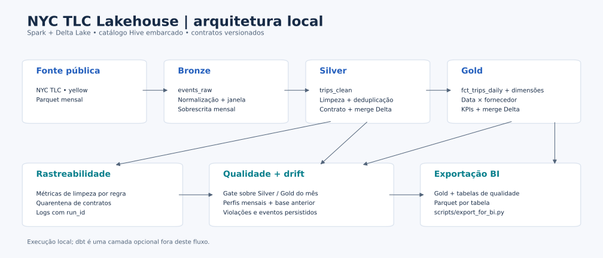
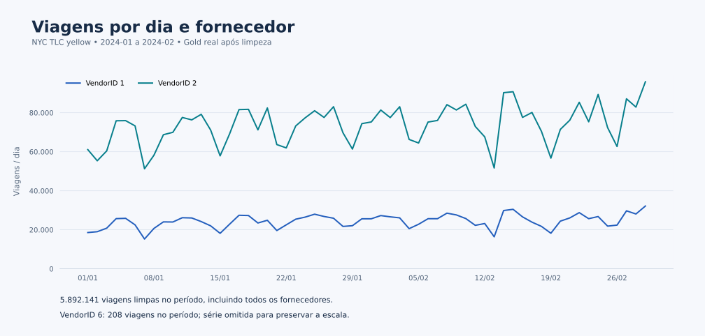
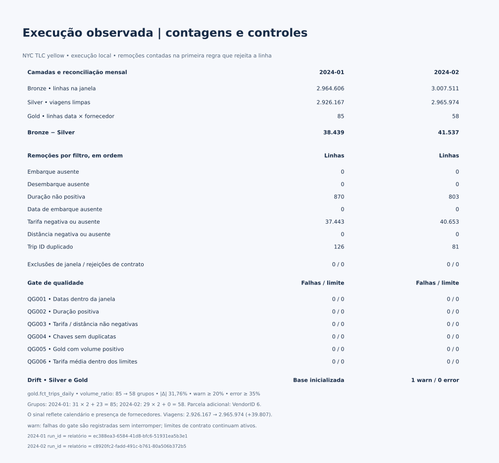

# NYC TLC Lakehouse

[](https://github.com/phaiffer/nyc-tlc-lakehouse/actions/workflows/ci-contracts.yml)

Local Spark + Delta Lakehouse project built as a production-style portfolio implementation. It ingests NYC TLC parquet data into a Medallion model (Bronze/Silver/Gold), enforces versioned data contracts, and persists quality outcomes (quarantine, rule violations, metrics, and drift events) using an embedded Hive metastore for deterministic local reruns.

## Architecture Overview

- Medallion flow:
  - `bronze.events_raw`: raw ingest with deterministic schema normalization/casts
  - `silver.trips_clean`: canonical trip model with contract enforcement and incremental merge
  - `gold.fct_trips_daily`: daily KPI fact with incremental merge
- Quality layer:
  - `quality.quarantine_records`: invalid rows rejected by contract rules
  - `quality.violations_summary`: quality gate rule outcomes with severity
  - `quality.pipeline_metrics`: stage-level run metrics
  - `quality.drift_events`, `quality.drift_baseline_metrics`: drift monitoring
- Reference dimensions:
  - `gold.dim_vendor`, `gold.dim_payment_type`, `gold.dim_rate_code`



## Quickstart

Supported local flow:

```bash
# Use a Spark-compatible interpreter; create the venv before make setup.
python3.12 -m venv .venv
# Linux example; point JAVA_HOME at your installed Java 21.
export JAVA_HOME=/usr/lib/jvm/java-21-openjdk-amd64
export PATH="$JAVA_HOME/bin:$PWD/.venv/bin:$PATH"
make setup
make download YEAR=2024 MONTH=1
make reset
make run YEAR=2024 MONTH=1
make inspect
make check
```

One-command local walkthrough:

```bash
make demo YEAR=2024 MONTH=1
```

`make demo` runs setup/download/reset/run/inspect and writes runtime artifacts at:

- `.local/logs/pipeline_<run_id>.jsonl`
- `.local/checkpoints/backfill_<run_id>.json`
- `.local/demo/demo_<run_id>.txt`

## Observed Results: January–February 2024

Local executions using the public monthly TLC **yellow** files. The counts below
cover each month's pickup window; Bronze applies that window before writing.
The Gold grain is `trip_date × vendor_id`.

| Measure | January 2024 | February 2024 |
| --- | ---: | ---: |
| Bronze: rows in the pickup window | 2,964,606 | 3,007,511 |
| Silver: cleaned trips | 2,926,167 | 2,965,974 |
| Gold: aggregated rows | 85 | 58 |
| Bronze − Silver | 38,439 | 41,537 |
| Quality rules evaluated | 6 | 6 |
| Failed rules | 0 | 0 |



Cleaning removals are stored in the Silver stage's JSON in
`quality.pipeline_metrics`. Each row is assigned to its **first rejecting rule**,
in the order below; duplicates are counted among rows that survived cleaning.
Missing (`NULL`) fares and distances are rejected. Zero fares and distances pass
the `>= 0` filters.

| Cleaning rule | January 2024 | February 2024 |
| --- | ---: | ---: |
| `missing_pickup_ts` | 0 | 0 |
| `missing_dropoff_ts` | 0 | 0 |
| `non_positive_duration` | 870 | 803 |
| `missing_pickup_date` | 0 | 0 |
| Negative or missing fare (`negative_or_null_fare`) | 37,443 | 40,653 |
| Negative or missing distance (`negative_or_null_distance`) | 0 | 0 |
| `duplicate_trip_id` | 126 | 81 |
| **Total removed** | **38,439** | **41,537** |

These sums exactly match Bronze − Silver. Additional window exclusions and
contract rejections were zero in both months; Silver and Gold reconciliations
also had zero differences. Recording cleaning metrics keeps quarantine dedicated
to contract violations without persisting another copy of the discarded rows.
First-rejection counts do not independently count every invalid condition in
the source.

The gate evaluated dates, duration, fare/distance, duplicates, Gold volume and
average fare per trip. The default **`warn` mode records gate failures without
interrupting execution**, including rules with `error` severity.
`STRICT_QUALITY=1` makes those rules fail the execution; `warn`/`info` rules
remain informational. Schema, uniqueness and contract rejection-limit checks
remain active in both modes. Drift events are persisted for observability.

January initialized the Silver and Gold drift baselines. February compared its
monthly profiles with those baselines: no Silver alert and one Gold
`volume_ratio` warning, from 85 to 58 aggregated groups (31.76% absolute change).
Gold volume counts date/vendor groups. Measurements from the actual Gold,
also recorded in the snapshot, explain the change:

| Month | VendorID | Gold rows / dates | Trips |
| --- | --- | ---: | ---: |
| 2024-01 | 1 | 31 | 729,016 |
| 2024-01 | 2 | 31 | 2,196,943 |
| 2024-01 | 6 | 23 | 208 |
| 2024-02 | 1 | 29 | 735,405 |
| 2024-02 | 2 | 29 | 2,230,569 |
| 2024-02 | 6 | 0 | 0 |

January has `31 × 2 + 23 = 85` groups; February has `29 × 2 + 0 = 58`.
The difference consists of fewer calendar days for vendors 1 and 2 and the
absence of VendorID 6 in February. Cleaned trips increased from 2,926,167 to
2,965,974, a gain of 39,807 trips. The warning describes calendar coverage and
vendor composition. The daily chart omits VendorID 6's series and states its
208 trips for the period in a footnote; totals and evidence still include it.



Reports use the same `run_id` as the Silver/Gold metrics and quality outcomes.
`quality.violations_summary` retains run history: filter or group by `dataset`,
`run_id`, `window_year` and `window_month` before counting rules. The
[severity example](analytics/examples.sql) keeps each run/window separate;
`scripts/export_for_bi.py` exports the complete history with those keys, and the
quality notebook counts only its current invocation/window. The optional dbt
models do not read this table.

Because Bronze is overwritten monthly, reports recover its count from the
corresponding execution's metrics. Full IDs, source-file hashes, drift profiles,
rules, per-vendor measurements and the aggregated Gold used in the chart are in
[showcase_results.json](docs/showcase_results.json).

### Reproduce the Showcase

After creating `.venv` with Python 3.12 and selecting Java 21 as shown in the
Quickstart, these commands keep caches and outputs local:

```bash
mkdir -p .local/tmp .local/matplotlib
export SPARK_LOCAL_IP=127.0.0.1
export PYSPARK_SUBMIT_ARGS="--conf spark.jars.ivy=$PWD/.local/ivy pyspark-shell"
export TMPDIR="$PWD/.local/tmp"
export MPLCONFIGDIR="$PWD/.local/matplotlib"
PIP_CACHE_DIR="$PWD/.local/pip-cache" make setup
make download YEAR=2024 MONTH=1
make download YEAR=2024 MONTH=2
make reset
make run YEAR=2024 MONTH=1
make run YEAR=2024 MONTH=2
.venv/bin/python scripts/demo_report.py --year 2024 --month 1
.venv/bin/python scripts/demo_report.py --year 2024 --month 2
make export-bi EXPORT_DIR=.local/showcase/exports
.venv/bin/python scripts/render_showcase_assets.py --months 2024-01 2024-02
```

Reset runs before January. February preserves January's state for incremental
merges and drift comparison. Silver and Gold accumulate months; quality,
drift and reconciliation select the monthly window. The renderer checks sums,
IDs, completion logs, reports and events before rendering. Raw Parquet, Delta
tables, metastore and exports stay in the ignored `data/raw/` and `.local/`
directories.

To reproduce only the SVGs from the versioned aggregate snapshot:

```bash
.venv/bin/python scripts/render_showcase_assets.py --snapshot docs/showcase_results.json
```

This demonstration covers a two-month sample of yellow taxi data, executed
locally with embedded Hive. It does not evaluate cloud deployment, distributed
scale, seasonality or production stability. The optional dbt workflow was not
executed in this validation. Figures use Portuguese for the Brazilian
institutional site. The [execution report](docs/SHOWCASE_REPORT.md) records
commands, results and verification limits.

## Developer Workflow

```bash
make fmt
make lint
make test
make check
make doctor
make verify
make run YEAR=2024 MONTH=1
make inspect
make reset
```

Defaults: `YEAR=2024`, `MONTH=1`.

## Optional dbt Layer Workflow

The dbt layer is optional and not part of `make check` or CI gates.

Prerequisites:

- Run the Spark pipeline first so dbt sources exist:

```bash
make reset
make run YEAR=2024 MONTH=1
make inspect
```

- Install dbt plus a compatible adapter (example local adapter):

```bash
.venv/bin/python -m pip install dbt-core dbt-spark
```

Run optional dbt targets:

```bash
make dbt-parse
make dbt-run
make dbt-test
make dbt-docs
```

Default Make variables:

- `DBT_DIR=dbt/lakehouse_dbt`
- `DBT_PROFILES_DIR=dbt/lakehouse_dbt/profiles`
- `DBT_TARGET=local`

Overrides:

```bash
make dbt-parse DBT_TARGET=local
make dbt-run DBT_PROFILES_DIR=/absolute/path/to/profiles_dir
```

dbt models built by this project:

- `stg_silver_trips_clean` (staging view from `silver.trips_clean`)
- `mart_daily_revenue` and `mart_vendor_profile` (optional marts for BI/dashboard use)

## Outputs

- `bronze.events_raw`: normalized raw source with ingest metadata.
- `silver.trips_clean`: cleaned, deduplicated trip-level model.
- `gold.fct_trips_daily`: daily vendor-level KPI mart (`trips`, `total_fare`).
- `gold.dim_vendor`: vendor semantics.
- `gold.dim_payment_type`: payment type lookup.
- `gold.dim_rate_code`: rate code lookup.
- `quality.quarantine_records`: contract-invalid rows + reason metadata.
- `quality.violations_summary`: append-oriented rule outcomes and thresholds;
  filter or group by dataset, run ID and monthly window before counting rules.
- `quality.pipeline_metrics`: structured Silver/Gold run metrics.
  Silver metrics include `cleaning_summary.removed_by_rule` and `row_accounting`
  to reconcile input rows, cleaning removals, month exclusions, contract rejections and output rows.
- `quality.drift_events`: emitted drift alerts by dataset/metric.
- `quality.drift_baseline_metrics`: baseline profiles used for drift comparison.

## Data Quality And Contracts

- Contracts live in `contracts/bronze`, `contracts/silver`, and `contracts/gold`.
- Contract `version` is mandatory; breaking changes require a version bump (enforced in CI).
- Silver/Gold contracts define `primary_key`, `watermark`, and `late_arrival_days`.
- Quarantine is append-oriented and stores rule metadata (`rule_id`, `severity`, `reason_code`, `run_id`, `run_ts`).
- Quality gate severity:
  - `error`: fails the run in strict mode.
  - `warn`/`info`: recorded for observability without strict failure.

## Idempotency And Incremental Merge

- Bronze applies deterministic type normalization before persistence to avoid rerun drift.
- Silver and Gold use deterministic dedup + Delta incremental merge keyed by contract PK.
- Merge windows use contract watermarks and a late-arrival lookback:
  - Silver: `updated_at`, 7 days
  - Gold: `trip_date`, 7 days
- Writes disable implicit schema evolution (`mergeSchema=false`) and use controlled table recreation only when schema conflicts are detected.

## Local Environment Notes

These warnings are expected in local embedded-metastore mode and do not indicate pipeline failure by themselves:

- Hive SerDe compatibility for Delta tables (`Couldn't find corresponding Hive SerDe ... delta`)
- native Hadoop library warning (`Unable to load native-hadoop library ...`)
- hostname loopback warning (`resolves to a loopback address ...`)

Inspect local catalog state with:

```bash
make inspect
```

The local metastore and warehouse used by the pipeline are under `.local/`:

- `.local/metastore_db`
- `.local/spark-warehouse`
- `.local/spark-local`
- `spark-warehouse` (root-level fallback artifact path in some local Spark sessions)

## Output Locations And Cleanup

- Local table outputs and catalog state:
  - `.local/spark-warehouse`
  - `.local/metastore_db`
  - `.local/spark-local`
  - `spark-warehouse`
- Downloaded monthly parquet:
  - `data/raw/`
- Optional filesystem snapshots (if used outside managed-table mode):
  - `lakehouse/`

Cleanup options:

```bash
make reset
rm -rf .local/spark-warehouse .local/metastore_db .local/spark-local spark-warehouse derby.log
rm -rf data/raw/*
```

## Troubleshooting

- Correct Spark SQL syntax:
  - `spark.sql("SHOW DATABASES").show()` (plural: `DATABASES`)
  - `spark.sql("SHOW TABLES IN silver").show()`
- If you use raw SQL strings, use:
  - `SHOW DATABASES`
  - `SHOW TABLES IN <db>`
- If objects seem missing, run `make inspect` first and confirm you are querying the same embedded metastore under `.local/`.
- If `make dbt-*` fails with `dbt CLI not found`, install `dbt-core` and an adapter (for local target: `dbt-spark`).
- If dbt reports adapter errors (for example `Could not find adapter type spark`), install or activate the adapter and re-run `make dbt-parse`.
- If dbt reports profile path issues, verify `dbt/lakehouse_dbt/profiles/profiles.yml` exists or override `DBT_PROFILES_DIR`.

## Additional Documentation

- [Documentation Index](docs/README.md)
- [Architecture](docs/architecture.md)
- [Operations](docs/operations.md)
- [Runbook (How To Run)](docs/runbook.md)
- [Data Quality](docs/data_quality.md)
- [Semantic Model](docs/semantic_model.md)
- [Contracts](docs/contracts.md)
- [Incremental](docs/incremental.md)
- [Drift Audit](docs/DRIFT_AUDIT.md)
- [Baseline Report](docs/BASELINE_REPORT.md)
- [Portfolio Hardening Report](docs/PORTFOLIO_HARDENING_REPORT.md)
- [Improvements Backlog](docs/IMPROVEMENTS_BACKLOG.md)
- [Empty Directories Policy](docs/EMPTY_DIRECTORIES_POLICY.md)
- [Troubleshooting](#troubleshooting)
- [Optional dbt Analytics Layer](dbt/lakehouse_dbt/README.md)
- [ADR-0001 Embedded Hive Metastore Constraints](docs/adr/0001-embedded-hive-metastore-constraints.md)
- [ADR-0002 Contract-Driven Schema Governance](docs/adr/0002-contract-driven-schema-governance.md)
- [ADR-0003 Incremental Merge and Reconciliation](docs/adr/0003-incremental-merge-reconciliation.md)
- [ADR-0004 Local Hive Metastore and Delta Tables](docs/adr/0004-local-hive-metastore-delta-managed-tables.md)
- [ADR-0005 Contracts and Quality Gate Enforcement](docs/adr/0005-contracts-and-quality-gate.md)
- [ADR-0006 Drift Metrics by Grain](docs/adr/0006-drift-metrics-by-grain.md)
